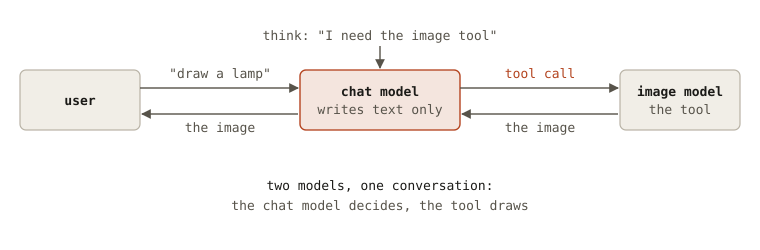

## Overview

On 14 May I went back to the University of Florence to give a seminar titled *"From LLMs to Agents"* 🤗. These notes follow my [slides](docs/seminar.pdf), minus the part on agentic Document AI, which deserves its own post.

Today's chat models are still Large Language Models: they read text and predict one token at a time. What changed is around them. They can *reason* before answering, *call tools*, and use [MCP](https://www.andreagemelli.me/posts/mcp/) to discover tools they have never seen.

You have probably used this already without noticing, every time you asked a chatbot for an **image**.


*The chat model never draws: it writes a tool call, a separate image model draws, and the picture comes back through the conversation.*

When you ask Gemini, ChatGPT or Claude for a picture, the model you are chatting with draws nothing, because all it produces is text. It writes a **tool call**, a structured piece of text meaning "run the image generator with this prompt", and a different model does the drawing. The picture comes back into the conversation and the chat model hands it to you 🪄

Web search, code execution, reading files and sending emails all work the same way: the chat client is an *orchestrator* around a model that only writes text.

Tools exist because LLMs are limited by design, which is what Part 01 of the seminar covered:

- **outdated information**: knowledge is frozen at training time;
- **no exact computation**: they happily hallucinate `273 x 1849`, or how many `r` are in *strawberry*;
- **no long-context planning**: no memory across calls, one forward pass at a time;
- **limited by language**: no way to interact with the *world*.

Underneath all of them, **LLMs are stateless**. The "chat" is simulated: every new token is generated by re-reading the whole conversation from the top, and there is nowhere else the model keeps information. So the only way to give it something new, a computation's result, today's weather, a web page, is to **put it in the context**. That is what a tool does.

## Agents & Tools

Let's borrow the definition from the [Hugging Face Agents Course](https://huggingface.co/learn/agents-course/unit1/introduction), Unit 1:

> "A system that leverages an AI model to interact with its environment in order to achieve a user-defined objective. It combines reasoning, planning, and the execution of actions - often via external tools - to fulfill tasks."

The course splits an agent in two parts:

- the **brain** is the LLM: reasoning, planning, deciding what to do next;
- the **body** is the set of tools: APIs, code execution, browsers. This is the agent's *capability space*.

An LLM without tools can describe the world but cannot act on it.

### The ReAct loop

The canonical way to wire brain and body together is **ReAct** [^0], from Yao et al., 2022: interleave *reasoning* and *actions*, so that each observation informs the next thought.

```python
while not done:
    thought = LLM(context)        # what to do next
    action = LLM(context)         # tool + arguments
    observation = tool(action)    # actually run it
    context += (thought, action, observation)
return final_answer
```

Three moves, repeated until the model emits a final answer:

- **Thought**: the LLM writes its reasoning as plain text (chain-of-thought);
- **Action**: the LLM emits a structured tool call;
- **Observation**: the *orchestrator* runs the tool and pastes the result back into the prompt.

The model never runs anything. It writes text shaped like a function call; your code parses it, runs the real function and appends the output to the conversation. The model then re-reads everything, since it is stateless, and decides the next step.

### Where a tool actually lives

A tool is an ordinary function in your codebase:

```python
from smolagents import tool

@tool
def get_weather(city: str) -> str:
    """Returns the current weather for a given city.

    Args:
        city: the name of the city, e.g. "Florence".
    """
    return requests.get(f"https://api.example.com/weather/{city}").json()["summary"]
```

The model never sees this code, only its *signature* serialised into a schema:

```json
{
  "type": "function",
  "function": {
    "name": "get_weather",
    "description": "Returns the current weather for a given city.",
    "parameters": {
      "type": "object",
      "properties": {
        "city": {"type": "string", "description": "the name of the city, e.g. Florence."}
      },
      "required": ["city"]
    }
  }
}
```

That schema is pasted as text into the system prompt. Here is a real one, taken from the [small reasoner I fine-tuned](https://huggingface.co/andreagemelli/Phi-3.5-mini-thinking-function_calling-V0) for this exact purpose:

```text
You are a function calling AI model. You are provided with function signatures
within <tools></tools> XML tags. You may call one or more functions to assist
with the user query. Here are the available tools:
<tools> [{'type': 'function', 'function': {'name': 'convert_currency', ... }}] </tools>
For each function call return a json object with function name and arguments
within <tool_call></tool_call> XML tags. Also, before making a call to a function
take the time to plan the function to take. Make that thinking process between
<think>{your thoughts}</think>
```

**The function lives on your machine, its description lives in the prompt.** Tool design is therefore ordinary software engineering: clear names, typed signatures and accurate docstrings, because the docstring is the interface the model programs against.

### Thinking is just more tokens

The last piece came with reasoning models. Training DeepSeek-R1-Zero [^1] with reinforcement learning alone, the authors describe an **"aha moment"** where the model learns by itself to stop, reconsider its approach and spend more tokens thinking before answering, because doing so was rewarded.

Since *thinking* and *tool calls* are both just tokens in the context, they combine naturally. The model reasons about which tool it needs, emits the call, the tool's output lands in the context like any other message, and reasoning resumes with one more fact available.

## Practical examples: ask grandma about super good recipes!

For the seminar I built one brain and one body 👩🏼‍🍳

### A brain: a small model that thinks, then calls

The first artifact is [**Phi-3.5-mini-thinking-function_calling-V0**](https://huggingface.co/andreagemelli/Phi-3.5-mini-thinking-function_calling-V0): `microsoft/Phi-3.5-mini-instruct` fine-tuned with SFT (TRL) on [`Jofthomas/hermes-function-calling-thinking-V1`](https://huggingface.co/datasets/Jofthomas/hermes-function-calling-thinking-V1). It is the bonus exercise of Unit 1 of the Agents Course, which uses Gemma; doing it with Phi meant adapting the chat template and special tokens, which is where most of the learning happened.

Asked to convert 500 USD to Euros, it produces:

```text
<think> Okay, so the user is asking to convert 500 USD to Euros. I need to figure out
which function to use. Looking at the available tools, there's a function called
convert_currency that does exactly that. It requires the amount, the currency to
convert from, and the currency to convert to. [...] </think>

<tool_call>
{'name': 'convert_currency', 'arguments': {'amount': 500, 'from_currency': 'USD', 'to_currency': 'EUR'}}
</tool_call>

<tool_response>
{'converted_amount': 425.5, 'from_currency': 'USD', 'to_currency': 'EUR'}
</tool_response>

Sure, 500 USD is approximately 425.50 Euros.
```

It is a toy model. It did not learn to convert currencies, and it computes nothing: it learned the **shape of the behaviour**, think first, emit a well-formed call, then stop and wait. The `425.5` comes from the tool, and the last sentence is the only part the model wrote after reading it.

### A body: an agent that raids the internet for recipes

The second artifact is a full agent, [**grandma_secret_sauce**](https://huggingface.co/spaces/andreagemelli/grandma_secret_sauce) 🍝, built with [smolagents](https://github.com/huggingface/smolagents) and running as a Space. It has web search plus one custom tool of mine:

```python
@tool
def grandma_secret_sauce(url: str) -> str:
    """This tool look at the urls provided and returns the recipe from a working, existing page.
    Args:
        url: list of url pages to scrape the recipe from.
    """
    try:
        html = urlopen(url).read().decode("utf-8")
        scraper = scrape_html(html, org_url=url)
    except:
        return f"Recipe not found for provided url: {url}."

    ingredients = [f" - {ing}\n" for ing in scraper.ingredients()]
    return f"""
👩🏼‍🍳 Et voilà! The {scraper.title()}!
Preparation requires {scraper.total_time()} minutes, and it is for {scraper.yields()} people.

🧂 Ingredients:\n
{''.join(ingredients)}
🥘 Instructions:
{scraper.instructions()}
"""
```

The agent itself is a few lines:

```python
agent = CodeAgent(
    model=model,
    tools=[final_answer, DuckDuckGoSearchTool(), grandma_secret_sauce],
    max_steps=10,
    prompt_templates=prompt_templates,
)
```

`CodeAgent` is a **code agent**: instead of emitting JSON, the model writes Python that runs in a sandbox. The other style is the JSON tool calling of the OpenAI, Anthropic and Gemini APIs; same idea, different serialisation.

Ask it *"I have eggs, guanciale and pecorino, what do I cook?"* and the ReAct loop runs: search the web, pick the most promising URL, call `grandma_secret_sauce(url)`, get a structured recipe, `final_answer`. If the page is not a recipe, the tool returns `"Recipe not found for provided url: ..."`. That is not a crash, just another observation, and the agent tries the next link 🔁

**None of the recipe knowledge is in the weights**: it is in [`recipe-scrapers`](https://github.com/hhursev/recipe-scrapers), a plain Python library. The model only decides *which function to run, on which URL, and when to stop*.

A practical hint I gave the students: use **Pydantic** for outputs and a linter like **ruff** on your tools. Types and docstrings are the API your model codes against.

## Conclusions

Three things to take home 🎓

1. **LLMs predict the next token.** Capable, but stateless and without tools of their own: the context is their only memory.
2. **Agents = LLM + loop + tools.** The loop lets the model iterate; the tools define what it can act on, and nothing else.
3. **The engineering is at the boundary**: which functions you expose, how you name and document them, and what you feed back into the context. The model chooses, your code acts.

The full deck, agentic Document AI included, is [here](docs/seminar.pdf).

Happy learning 🤗

## References

[^0]: Yao, et al., "ReAct: Synergizing Reasoning and Acting in Language Models", [arXiv:2210.03629](https://arxiv.org/abs/2210.03629), 2022
[^1]: DeepSeek-AI, "DeepSeek-R1: Incentivizing Reasoning Capability in LLMs via Reinforcement Learning", [arXiv:2501.12948](https://arxiv.org/abs/2501.12948), 2025
