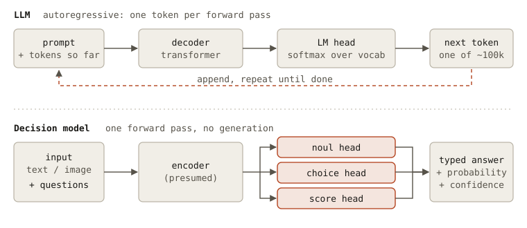

## Overview

**Decision models**, also called *System One* models with Jev as the poster child, read an input and a few predefined questions, and answer with a **typed decision and a calibrated probability**. They never write a sentence.

They are not revolutionary, and that is exactly why they are useful: a well-known task, classification, served through an API that feels like an LLM, at a fraction of the cost.

*Top: an LLM picks one token among the whole vocabulary, appends it, and goes again. Bottom: a decision model answers every question in one forward pass, with a head per question type.*

## Classification in two minutes

Classification is the task of choosing a label (or several, or a score) for an input. The usual path goes from bag-of-words with logistic regression, to RNNs and CNNs, to transformers like BERT with a classification head on top. [Sebastian Raschka's walkthrough](https://magazine.sebastianraschka.com/p/classifier-history-and-jev) [^0] covers every era with numbers, and is the best place to read the history.

The catch of the classical recipe: a classifier only knows the labels it was trained on. When the labels change or the data drifts, you collect data, label it, retrain and redeploy. In production, that can happen every week.

## What a decision model is

The [Papers with Code definition](https://paperswithcode.co/methods/decision-model) [^1] is a clear one: a model that maps *unstructured state directly to a typed decision over predefined options*, with calibrated probabilities. Simply put, a smart `if` statement.

Providers are converging on the same three question types, so I will stick to those names:

- **noul**: a yes/no question, with a probability;
- **choice**: pick one option among several;
- **score**: rate on a scale.

Jev, from TypeSafe AI, introduced the category as the "ChatGPT moment" of decisions [^2]. Its rightful counterpart is [Laya](https://github.com/NandhaKishorM/laya), the open-source decision model of an independent researcher who says they built non-autoregressive decision models before Jev's launch, and wrote about it in a [post](https://dev.to/nandakishor_m_6cc0adfde9f/i-built-non-autoregressive-decision-models-a-year-ago-then-a-frontier-lab-called-it-a-18me) [^6] worth reading. The priority claim is their own account and I cannot verify it. What I can say is that Laya is open, and it is what lets the rest of us look inside this kind of model: no funding round, no bold claims, just a clear explanation.

The state of the art, at least up to this week, is [d1-ultra](https://www.liquid.ai/blog/d1-ultra) from Liquid AI [^3]: multimodal, with a probability for each possible answer and *no token generated*. The performance claims are the vendor's own.

### How it (probably) works

Neither company fully discloses the architecture, so this is an informed guess. My bet is that it is **not revolutionary per se**: most likely an *encoder-only* backbone with classification heads, instead of the language-modeling head of an LLM, which picks among the whole vocabulary to decide the next token. The open-source Laya, for instance, reportedly sits on a ModernBERT-large encoder [^4], and Liquid describes d1-ultra as built on an open-weight model, read in a single forward pass [^3].

The output side is the interesting part. Instead of squeezing a probability out of the logprobs of the next token, it seems that **two streams are trained specifically**:

- a **general confidence** in the answer, which is what you use to *escalate* to a more capable model when it is low;
- a **task-scoped probability**: for a noul, the true/false probability rescaled for that specific question.

This is my reading of the public material, not a spec. But it is the design choice that makes the whole thing usable: a model that tells you *when it does not know*.

### Not just a classifier

Raschka calls Jev "essentially a text classifier", and then explains why it is not *just* one [^0], and I agree: a *traditional* classifier needs new data and a new training run for every change, while a decision model **generalizes across tasks and can still be fine-tuned without losing that**. You change the question, not the model.

## Versus an LLM

LLMs are amazing reasoners and, with tools, great agents. But most decisions in a pipeline do not need chain of thought, or any effort at all:

- *is this message a complaint?*
- *which of these four agents should handle this request?*
- *is this document relevant to this query?*

In the era of API calls, a decision model costs next to nothing compared to an LLM, and answers in a fraction of the time. TypeSafe quotes [pricing and latency](https://typesafe.ai/blog/introducing-system-one-models-and-jev) orders of magnitude below frontier LLMs [^2], with the honest caveat that the pricing may be subsidized. Sometimes an "intelligent" and cheaper **router** is all you need.

There are limits. In *JEV-as-a-Judge* [^5], a decision-only judge gets within three points of a strong LLM when the verdict can be read from the text, and falls behind when it has to be *derived* (math, code, logic). The confidence is what flags that boundary, which brings us to the pattern that makes everything click.

## Accept when confident, escalate when unsure

A **cascade**: the decision model answers first, and only the uncertain cases go to the expensive model. It fits in many places:

- **routing**, such as picking the right agent or harness for a request (Paul Iusztin lists [six places to use Jev in production](https://www.linkedin.com/feed/update/urn:li:activity:7513277530624282624/) [^7], from routing and guardrails to tool-call gating and reranking);
- **LLM-as-a-judge**, with confident verdicts accepted and the rest escalated, as in the paper above;
- **synthetic labeling** of benchmarks, where the strong model only sees the hard items.

At [Kleio](https://www.kleio.ai), I used the cascade on two internal problems: an LLM judge for agent conversations, and synthetic relevance annotation for a retrieval benchmark, following the idea of [JEV-as-a-Judge](https://arxiv.org/abs/2609.26550) [^5].

On the judge, cost dropped by 71% and latency by 70%, with 97.2% agreement with the strong judge alone, even though 43% of the turns still escalated. On annotation, only 3.9% of the pairs reached the strong model, cost dropped by about 93%, and agreement with human labels went from 84.8% to 85.9%.

The gain is roughly **80% less cost** on average, with quality intact. And it holds at both ends: when almost half of the cases escalate, and when almost none do. Whatever the level of the task, a router that knows when to ask for help saves computation.

## Conclusions

Three things to take home 🎓

1. **A decision model is a classifier you call like an LLM.** Typed answers, calibrated probabilities, one forward pass, no generation.
2. **The value is in the confidence.** Knowing when *not* to answer is what lets you escalate to a bigger model and pay for it only when needed.
3. **Use the big model to think, and the small one to decide.** Most of a pipeline is the second kind.

Classification is nothing new, and neither is most of this architecture. What decision models bring back is a principle: **intelligence should be calibrated to the task**. LLMs took the industry by storm, and the reflex became to send everything to the latest, biggest model. That is a waste of money, energy and time, because most tasks, for most people, do not need a frontier model. Decision models may not be the breakthrough, but they point in the right direction: efficiency and calibrated judgment together, with the right amount of intelligence called in when it matters.

Happy learning 🤗

## References

[^0]: Raschka, "Language Models for Text Classification: From Bag-of-Words to Jev", [Ahead of AI](https://magazine.sebastianraschka.com/p/classifier-history-and-jev), 2026
[^1]: ["Decision model"](https://paperswithcode.co/methods/decision-model), Papers with Code
[^2]: TypeSafe AI, ["Introducing System One Models & Jev"](https://typesafe.ai/blog/introducing-system-one-models-and-jev), 2026
[^3]: Liquid AI, ["d1-ultra: Introducing the World's Best Decision Model"](https://www.liquid.ai/blog/d1-ultra), 2026
[^4]: Laya, [GitHub repository](https://github.com/NandhaKishorM/laya). The ModernBERT-large detail comes from a secondary source, [WWT](https://www.wwt.com/blog/the-rise-of-decision-models)
[^5]: Li et al., "JEV-as-a-Judge: Accept When Confident, Escalate When Unsure", [arXiv:2609.26550](https://arxiv.org/abs/2609.26550), 2026
[^6]: Nandakishor M, ["I Built Non-Autoregressive Decision Models a Year Ago. Then a Frontier Lab Called It a Breakthrough"](https://dev.to/nandakishor_m_6cc0adfde9f/i-built-non-autoregressive-decision-models-a-year-ago-then-a-frontier-lab-called-it-a-18me), DEV Community, 2026
[^7]: Iusztin, ["There are 6 places I'd use Jev in a production AI system"](https://www.linkedin.com/feed/update/urn:li:activity:7513277530624282624/), LinkedIn, 2026
