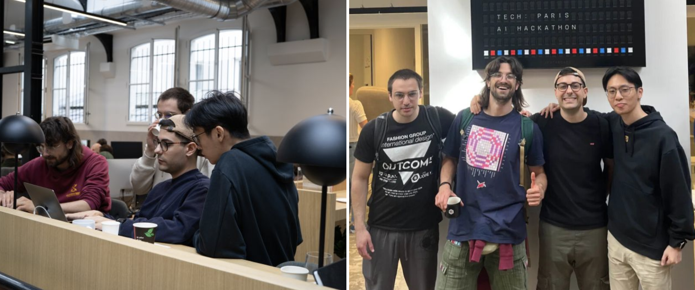

## Introduction

We just won 3rd place 🥉 at the Paris AI Hackathon 🏆 with **EasyMCP**, a tool that turns an OpenAPI specification into an MCP server. Before telling you how it went, let me explain why such a bridge is useful, starting from how the two differ.

## OpenAPI

OpenAPI (formerly Swagger) is a language-agnostic specification for describing HTTP APIs: which endpoints exist, what they accept, and what they return. It is maintained by the [OpenAPI Initiative](https://www.openapis.org/) ([spec](https://spec.openapis.org/oas/v3.1.1.html), [guides](https://learn.openapis.org/)).

```yaml
openapi: 3.0.0
info:
  title: Weather API
  version: 1.0.0
paths:
  /weather:
    get:
      summary: Get current weather
      parameters:
        - name: city
          in: query
          required: true
          schema:
            type: string
      responses:
        '200':
          description: Weather data
          content:
            application/json:
              schema:
                type: object
                properties:
                  temperature:
                    type: number
                  condition:
                    type: string
```

From this file a developer, or a code generator, knows exactly how to call the API. It works as documentation, validation schema and contract at once.

## MCP

The [Model Context Protocol](https://modelcontextprotocol.io/introduction), [introduced by Anthropic in November 2024](https://www.anthropic.com/news/model-context-protocol), standardises how an LLM application discovers and calls external tools and data sources. The docs call it "a USB-C port for AI applications" 🔌. OpenAI and Google DeepMind have since adopted it, and the [specification](https://modelcontextprotocol.io/specification/2025-03-26) is public.

The audience is the difference: **OpenAPI describes an API to a developer, MCP describes a tool to a model**. With the official Python SDK, a tool is a decorated function:

```python
from mcp.server.fastmcp import FastMCP

mcp = FastMCP("weather-tools")

@mcp.tool()
def get_weather(city: str) -> dict:
    """Get the current weather for a city."""
    return {"city": city, "temperature": 22, "condition": "sunny"}

if __name__ == "__main__":
    mcp.run()
```

The name, docstring and type hints become the schema the model reads, so writing a good tool mostly means writing a good description. If you want to see how a model actually picks and calls a tool, I go through it from scratch in [From LLMs to Agents](https://www.andreagemelli.me/posts/agents/).

In short, reach for OpenAPI when the consumer is a developer or an existing REST toolchain, and for MCP when the consumer is an agent that has to discover and pick tools on its own.

## Translating one into the other

Many companies already have well-specified OpenAPI APIs and now want agents to use them. Converting is more than changing format: an endpoint describes *how* to call something, while a good tool also tells the model *when* to call it.

```text
# OpenAPI endpoint
GET /users/{id}/orders?status=pending

# As an MCP tool
{
  "name": "get_user_pending_orders",
  "description": "List the pending orders of a user. Use it when the user asks about orders not yet shipped.",
  "inputSchema": {
    "type": "object",
    "properties": {"user_id": {"type": "string"}},
    "required": ["user_id"]
  }
}
```

Doing this by hand for every endpoint is slow and easy to get wrong. [EasyMCP](https://github.com/remorses/easymcp) reads an OpenAPI spec and generates the MCP server for you, so an existing API becomes usable by an agent without rewriting it.

## The hackathon 🏆

EasyMCP was born at the Paris AI Hackathon, organized by [TechEurope](https://blog.techeurope.io/p/hackathon-paris-1) and sponsored by big players such as HuggingFace, Mistral AI and ElevenLabs. MCP was barely six months old, and the gap was easy to see: most APIs were described in OpenAPI, and agents could not use them. We spent the hackathon building the bridge, and the jury ranked it 3rd 🥉. Not bad for a hackathon project, and a good sign that the need is real.


*The amazing team!*

Thanks to the organizers and the sponsors, and to my teammates 🤗

## Looking forward

I expect the two to coexist. OpenAPI keeps its role for service-to-service communication, with a [large tooling ecosystem](https://openapi.tools/) behind it. MCP is becoming the default integration layer for agents, with Microsoft adding it to [Windows 11](https://blogs.windows.com/windowsexperience/2025/05/19/securing-the-model-context-protocol-building-a-safer-agentic-future-on-windows/) and [Copilot Studio](https://www.microsoft.com/en-us/microsoft-copilot/blog/copilot-studio/introducing-model-context-protocol-mcp-in-copilot-studio-simplified-integration-with-ai-apps-and-agents/). Tools that bridge the two let teams reuse the APIs they already have 🤗

**Resources**
- [OpenAPI Specification](https://spec.openapis.org/oas/v3.1.1.html)
- [Model Context Protocol documentation](https://modelcontextprotocol.io/)
- [MCP GitHub organization](https://github.com/modelcontextprotocol): SDKs and reference servers
