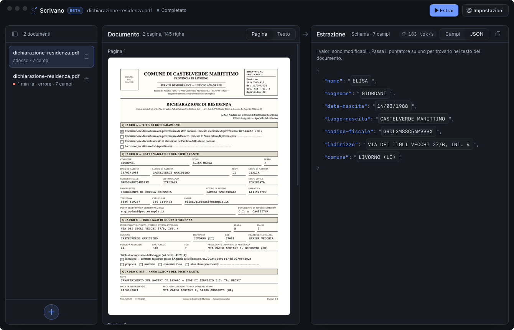

## Introduction

Key information extraction (KIE) usually works like this: a scan of a form goes to a server, a large model reads it, and structured data comes back. The document, often the most sensitive thing a person owns, has left their machine.

Identity cards, residency declarations, tax codes, bank details: for these documents I would rather lose a few points of accuracy than send them to someone else's GPU. So the question I started from was a practical one: **how small can a model be and still extract fields well enough to run locally, on a CPU, with nothing leaving the laptop?**

To answer it for Italian forms I built two things, both open on Hugging Face 🤗

- a **dataset**, [xfund-kie-it](https://huggingface.co/datasets/andreagemelli/xfund-kie-it): Italian XFUND converted into a schema-to-JSON extraction task;
- a **model**, [LFM2.5-350M-IT-Extract](https://huggingface.co/andreagemelli/LFM2.5-350M-IT-Extract): a 350M model fine-tuned on it, also as a 219 MiB [GGUF](https://huggingface.co/andreagemelli/LFM2.5-350M-IT-Extract-GGUF) that needs no GPU, no API key and no network.

## Why local

Running locally is a design decision, not a deployment detail. It sets the constraints for everything else:

- **the model has to be small**: it must fit inside an installer and answer in seconds on a laptop CPU;
- **the output has to be structured**: a JSON object the user can check field by field, not free text;
- **the whole pipeline has to be offline**, OCR included, so that the form, the extracted values and the history stay on the machine.

A frontier model would score higher. But for personal documents, keeping the data on the device is worth more to me than the gap.

## The dataset

There was no Italian KIE dataset in this shape, so I built one from the Italian split of **XFUND**[^4], a multilingual form-understanding benchmark.

The conversion starts from 4,882 question→answer links, maps their labels to a controlled set of keys (2,757 survive, 56%), then drops multi-answer labels and conflicting duplicate keys. The result is **199 documents, 1,461 fields and 37 extraction keys**, each with a natural-language description (`codice-fiscale`, `nome-completo`, `data-nascita`, `iban`, ...), split **149 train / 50 validation**.

Each example pairs a document's text and a field schema with the target JSON. 149 training documents is small, and the results below reflect that.

## The model

The base is [`LiquidAI/LFM2.5-350M`](https://huggingface.co/LiquidAI/LFM2.5-350M)[^2], fine-tuned with SFT (TRL[^3]) to take a document's text plus a field schema and emit a JSON object, omitting fields it cannot find.

At this scale the model does not learn Italian or Italian bureaucracy. It learns a discipline: find the value, put it under the right key, close the brace.

## Results

On the 50-document validation split, with greedy decoding:

| Model | Avg F1 | JSON parse failures |
|---|---|---|
| `LiquidAI/LFM2.5-350M` (base) | 0.2877 | 6 / 50 |
| **`LFM2.5-350M-IT-Extract`** | **0.6639** | 10 / 50 |
| same, Q4_K_M GGUF | 0.6635 | 10 / 50 |
| same, Q4_K_M on OCR text | 0.5662 | 10 / 50 |

- **Fine-tuning more than doubles F1** (0.29 → 0.66) with only 149 documents.
- **Q4_K_M quantisation costs almost nothing** (0.6639 → 0.6635), so the model that ships is the model that was measured.
- **OCR costs about 0.10 F1.** Clean text shows what the model can do; ~0.57 is the end-to-end number once pixels have to become text first.
- **Parse failures went up** (6 → 10), something the next round of training data needs to fix.

These are **upper bounds**: the schema is oracle-filtered (the model is only asked for fields the document contains), parse failures are excluded rather than scored as zero, and the metric double-counts a wrong value. Everything is reproducible with `uv run main.py`.

## Limitations

- Trained on 149 documents, so it is **very sensitive to the field descriptions**: edit those before blaming the document.
- Only **single-page Italian** documents are tested.
- **Valid JSON is not guaranteed**: 10/50 outputs failed strict parsing.
- A correct-looking value under the *wrong* key is not caught.

## Trying it: Scrivano

To use the model without writing code, I wrapped it in [Scrivano](https://github.com/andreagemelli/scrivano) 📝, a small desktop app (~280 MB installed) with the model bundled inside. You drop in a PDF or an image, pick or edit the fields you want, and get streamed JSON back, with each value linked to its position on the page. OCR runs locally too (PP-OCRv5[^1]), and values found nowhere on the page are flagged as likely inventions. Builds are on the [releases page](https://github.com/andreagemelli/scrivano/releases/latest).

*The sample residency declaration loaded: fields on the left, streamed JSON on the right.*

## Conclusions 🎁

1. **Local inference is a feature.** For personal documents, keeping data on the device is worth more than a few points of accuracy.
2. **A small fine-tuned model is enough for structured extraction.** 350M parameters and 149 documents take F1 from 0.29 to 0.66.
3. **Report upper bounds as upper bounds.** Oracle schema, excluded parse failures and a lenient metric all inflate the number, so say so.

Happy extracting 🤗

## Update: eight languages and a second task

Since this post I released a second round, all in one [Hugging Face collection](https://huggingface.co/collections/andreagemelli/documents-key-information-extraction):

- **Data and benchmark**: [xfund-docai-xl](https://huggingface.co/datasets/andreagemelli/xfund-docai-xl) extends the dataset to seven XFUND languages plus 350 generated pages, with document classification (12 classes) next to extraction: 2,519 training and 785 validation rows, the latter now also used as the benchmark, English (from FUNSD) included.
- **Model**: [LFM2.5-350M-Extract-ML-LoRA](https://huggingface.co/andreagemelli/LFM2.5-350M-Extract-ML-LoRA) (also as [GGUF](https://huggingface.co/andreagemelli/LFM2.5-350M-Extract-ML-LoRA-GGUF)), a LoRA fine-tune on it. It reaches **0.75 F1** across eight languages and both tasks, against 0.26 for the base model, with only 3 non-parsing outputs in 785. It now powers Scrivano.

Same size, same laptop, still offline 🔒

## References

[^1]: PaddlePaddle, ["PP-OCRv5"](https://github.com/PaddlePaddle/PaddleOCR), PaddleOCR, 2025
[^2]: Liquid AI, [*LFM2 Technical Report*](https://arxiv.org/pdf/2511.23404), 2025
[^3]: Hugging Face, [*TRL: Transformer Reinforcement Learning*](https://github.com/huggingface/trl)
[^4]: Xu, et al., "XFUND: A Benchmark Dataset for Multilingual Visually Rich Form Understanding", [Findings of ACL 2022](https://aclanthology.org/2022.findings-acl.253/)
